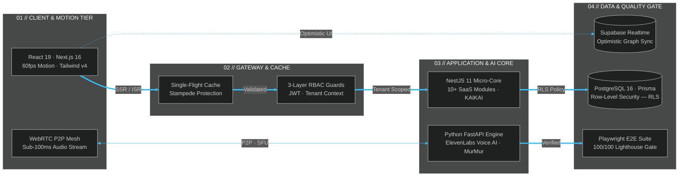

<div align="center">

<!-- 01–04 // MASTER ATELIER NOIR ARCHITECTURAL MONOLITH -->
<a href="https://ttanphat.vercel.app/">
  
</a>

<!-- 05 // LIVE SKILL RADAR, CI/CD PIPELINE CONVEYOR & SAIGON BASE STATION HUD -->


<!-- 06 // INTERACTIVE 3D MECHANICAL KEYCAP COMMAND DOCK -->


<p align="center">
  <a href="https://ttanphat.vercel.app/"></a>
  <a href="https://website-kaikai.vercel.app/"></a>
  <a href="https://murmur-voice.vercel.app/"></a>
  <a href="https://ttanphat.vercel.app/projects"></a>
  <a href="mailto:ttanphat.work@gmail.com"></a>
</p>

<!-- 07 // TELEMETRY CLOSING RAIL (COMPLETES THE CONTINUOUS ARCHITECTURAL SPINE) -->


<!-- 08 // UNIFIED EXECUTIVE TECHNICAL DOSSIER (SINGLE EXPANDABLE DRAWER) -->
<details>
  <summary><code>08 // SYSTEM ARCHITECTURE TOPOLOGY, PRODUCTION SLA &amp; CLI VERIFICATION</code> &nbsp;<sub><b>[EXPAND DOSSIER ▾]</b></sub></summary>
  <br />



  | ID | Production System | Domain &amp; SLA Metric | Architectural Engineering Highlights | Primary Core Stack | Live Endpoint |
  | :---: | :--- | :---: | :--- | :--- | :---: |
  | `01` | **KAIKAI** | `Multi-Tenant SaaS`<br/>**10+ Modules · PG RLS** | • **Single-flight cache** stampede protection on high-concurrency booking reads<br/>• **3-layer RBAC** guards &amp; **PostgreSQL 16 Row-Level Security (RLS)** isolation | `Next.js 16` `NestJS 11` `PostgreSQL` `Prisma` `Supabase` | [**Launch App ↗**](https://website-kaikai.vercel.app/) |
  | `02` | **MurMur** | `Realtime Voice AI`<br/>**&lt;100ms P2P Audio** | • Low-latency **WebRTC peer-to-peer** voice rooms with sub-100ms audio routing<br/>• **Python FastAPI** orchestrator + **ElevenLabs** conversational AI voice synthesis | `Next.js` `FastAPI` `Python` `WebRTC` `ElevenLabs` | [**Launch App ↗**](https://murmur-voice.vercel.app/) |
  | `03` | **Social Learning** | `Academic Graph`<br/>**Optimistic Sync** | • Instant **optimistic UI** feed mutations &amp; cache invalidation via **TanStack Query**<br/>• Live collaborative study channels powered by **Supabase Realtime** &amp; RLS | `React 19` `TypeScript` `Supabase` `Zustand` `Docker` | [**Case Study ↗**](https://ttanphat.vercel.app/projects) |
  | `04` | **Atelier Noir** | `Design Engineering`<br/>**100/100 Lighthouse** | • **60fps spring-physics** motion system, Lenis smooth scroll &amp; zero layout shift<br/>• Verified **100/100 Core Web Vitals** with automated **Playwright E2E** CI suite | `React 19` `TypeScript` `Tailwind v4` `Motion` `Playwright` | [**Launch App ↗**](https://ttanphat.vercel.app/) |

  <div align="left">

  ```bash
  # Quick-Verify Live Production Endpoints & Edge TLS Headers
  curl -ILs https://ttanphat.vercel.app/ https://website-kaikai.vercel.app/ https://murmur-voice.vercel.app/ | grep -E "HTTP/|server|x-vercel-cache"
  ```

  </div>
</details>

</div>
